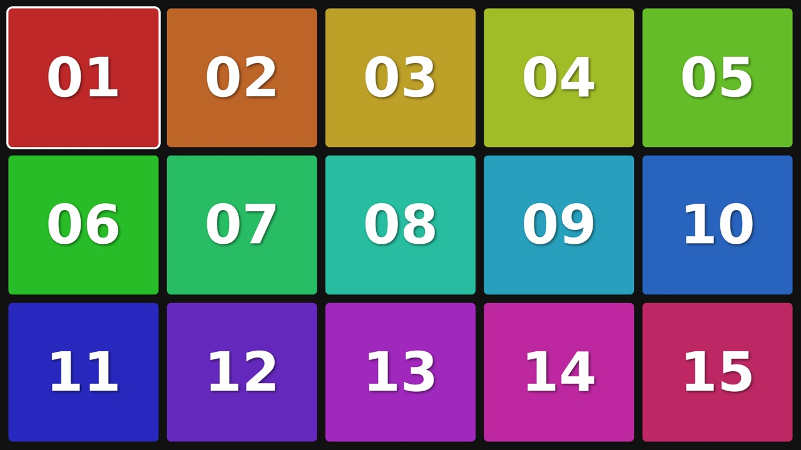
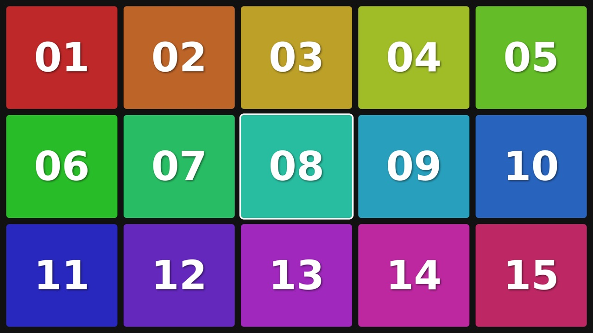
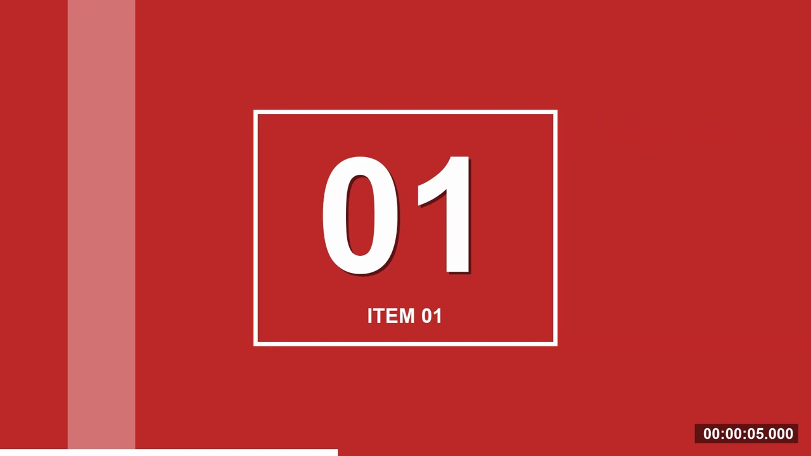
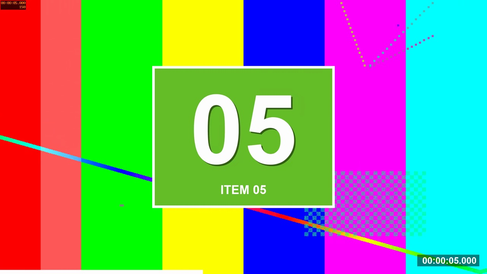
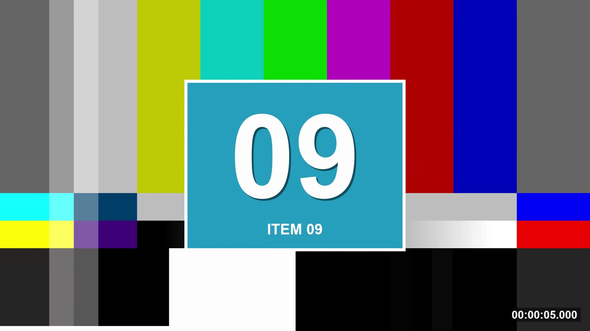

# BrightSign IR Remote Demo

A small HTML app for BrightSign players that shows a 5×3 menu of numbered tiles. Move around the menu with the arrow keys and press Enter to play that tile's video. You can use a **USB keyboard**, the **BrightSign IR remote (RC-1002)**, or both at the same time.



| Moving the selection | Playing an item |
|---|---|
|  |  |
|  |  |

## What you need

- A BrightSign player with a 3.5mm **IR In** port. This demo was tested on an XD1036 running BOS 9.1.149.
- The BrightSign IR receiver plugged into the **IR In** port.
- The BrightSign RC-1002 remote, which sends NEC codes.
- An SD card.

## How it works

1. **`autorun.brs` starts the app.** When the player boots, it runs `autorun.brs` from the root of the SD card. That script opens `app/index.html` full screen in an `roHtmlWidget`. It sets `brightsign_js_objects_enabled: true`, which gives the page access to BrightSign's JavaScript objects, including the IR receiver.
2. **The page listens to the keyboard and the remote.** Both kinds of input are turned into the same small set of actions (`up`, `down`, `left`, `right`, `enter`), which then go to one shared function. That's why either input method works, and you can switch between them at any time.
3. **The remote is read with `BSIRReceiver`.** In [`app/scripts.js`](app/scripts.js) the page creates:

   ```js
   irReceiver = new BSIRReceiver("IR-in", "NEC");
   irReceiver.onremotedown = function (e) { handleIrCode(e.code, false); };
   irReceiver.onremoterepeat = function (e) { handleIrCode(e.code, true); };
   ```

   Each button press gives you a 24-bit NEC code. The top 16 bits are the remote's manufacturer code (`0x6F90` for the RC-1002), and the bottom 8 bits identify the button. The app ignores codes from other remotes. When you hold an arrow button the selection keeps moving; holding OK doesn't restart the video.

4. **Pressing Enter or OK plays the selected video full screen.** When the video ends, the menu comes back.

### Button mapping

| Action | Keyboard | RC-1002 button | NEC button code | Full code (decimal) |
|---|---|---|---|---|
| Up | ↑ | Up | `0x12` | 7311378 |
| Down | ↓ | Down | `0x13` | 7311379 |
| Left | ← | Left | `0x10` | 7311376 |
| Right | → | Right | `0x11` | 7311377 |
| Select / play | Enter | OK | `0x14` | 7311380 |
| Stop video | X | — | — | — |

To add more buttons, look up their codes on the RC-1002 page linked below and add them to `irActions` in `app/scripts.js`.

## Reference links

- **RC-1002 remote: button list and NEC codes.** https://docs.brightsign.biz/hardware/rc-1002-remote-control
- **BSIRReceiver: the BrightScript-JavaScript object used to read the remote.** https://docs.brightsign.biz/develop/bsirreceiver
- **roHtmlWidget: options used in `autorun.brs`.** https://docs.brightsign.biz/develop/rohtmlwidget

## Project layout

```
autorun.brs              Starts the app and sets up the Local DWS
app/
  index.html             Page markup
  scripts.js             Menu, keyboard and IR remote handling
  assets.js              Tile colors and video list
  styles.css             Full-screen 5x3 grid
  videos/item01-15.mp4   12-second H.265 test clips (about 22 MB total)
tools/make-videos.sh     Rebuilds the test clips with ffmpeg
docs/screenshots/        Images used in this README
```

## Deploy to a player

1. Copy `autorun.brs` and the `app/` folder to the root of an SD card. You don't need `docs/` or `tools/` on the player.
2. Put the SD card in the player, plug in the IR receiver, and power the player on.

Every IR button press is logged to the page's JavaScript console, for example `IR down NEC 7311378` for Up. That's the quickest way to check that the remote is being read.

### Local DWS (the player's built-in web server)

On every boot, `autorun.brs` also turns on the player's **Local Diagnostic Web Server (LDWS)** with **no password** (user `admin`), so you can upload files and check the player from a browser while you develop. It only reboots the player when a setting actually changes, so there's no reboot loop. **Before you use this on a production player, remove `EnableLocalDWS()` or set a password.**

### Debugging with Chrome DevTools (optional)

`autorun.brs` sets up the web inspector on port 2999. To turn it on, set the registry key `html` / `enable_web_inspector` to `1` and reboot. Then open `chrome://inspect` in Chrome, add `<player-ip>:2999`, and click **inspect**. Turn it off again for production.

## Rebuilding the test videos

Each clip shows its item number on a panel that is the same color as its tile, plus a running timecode and a progress bar. The backgrounds rotate through a solid color with a moving bar, an animated test pattern, and SMPTE color bars.

```sh
tools/make-videos.sh
```

You need `ffmpeg` built with `libx265` and `drawtext`. The script uses Arial Bold from macOS by default; set `FONT=/path/to/font.ttf` to use a different font. If you change the colors, update both `COLORS` in the script and `boxColors` in `app/assets.js`.
